# EDA Report (auto-generated from executed analysis)

Rows analysed: 307,511. Overall historical target rate: 8.07%.

### Target distribution
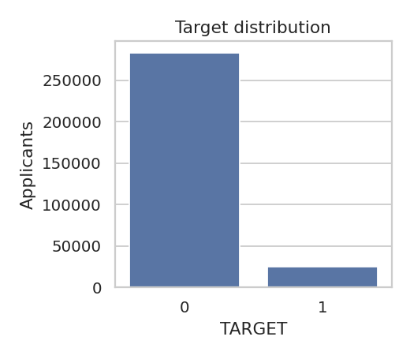

- **What is analysed:** Share of applicants labelled TARGET=1 (repayment difficulties per the competition's definition).
- **Why it matters:** Class imbalance drives metric choice, resampling and calibration decisions.
- **Observation (computed):** 24,825 of 307,511 applicants are TARGET=1 (8.07%).
- **Business interpretation:** Heavily imbalanced -> accuracy is misleading; use ROC-AUC/PR-AUC/KS and calibrated probabilities.
- **Limitations:** Label reflects the dataset's historical definition, not a universal default event.

### Applicant age
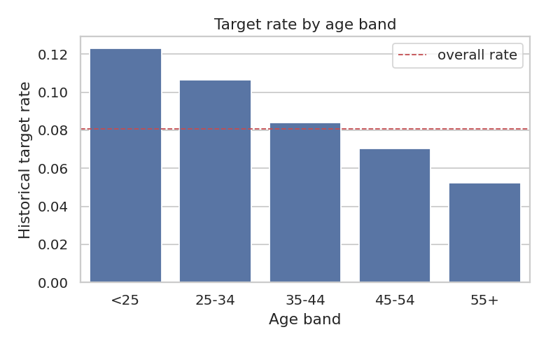

- **What is analysed:** Historical target rate by age band.
- **Why it matters:** Age is a common correlate of repayment; also relevant for fairness review.
- **Observation (computed):** <25: 12.29% (n=12,233); 25-34: 10.66% (n=72,429); 35-44: 8.41% (n=84,261); 45-54: 7.05% (n=70,190); 55+: 5.22% (n=68,398)
- **Business interpretation:** Compare band rates with the overall rate to see where risk concentrates.
- **Limitations:** Association only; age bands have unequal sizes.

### Income distribution
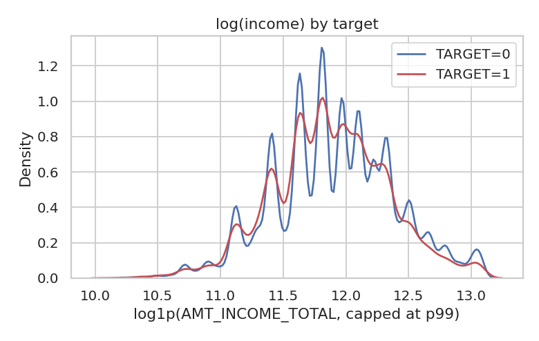

- **What is analysed:** Density of log income per target group (capped at the 99th percentile).
- **Why it matters:** Income capacity affects affordability.
- **Observation (computed):** Median income TARGET=1: 135,000; TARGET=0: 148,500.
- **Business interpretation:** Overlapping distributions imply income alone separates groups weakly.
- **Limitations:** Income is self-reported/unverified in parts; heavy right tail.

### Employment duration
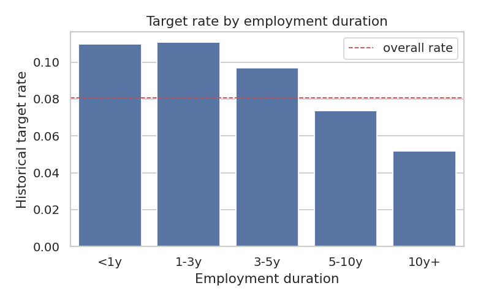

- **What is analysed:** Target rate by length of current employment (365243 sentinel treated as missing).
- **Why it matters:** Job stability signals income continuity.
- **Observation (computed):** <1y: 10.97%; 1-3y: 11.07%; 3-5y: 9.67%; 5-10y: 7.37%; 10y+: 5.19%
- **Business interpretation:** Shorter tenure groups with higher rates would indicate stability risk.
- **Limitations:** Sentinel group (unemployed/pensioners) excluded from this chart.

### Credit amount relative to income
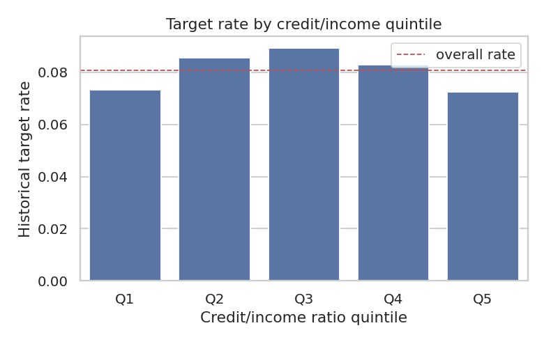

- **What is analysed:** Target rate by quintile of AMT_CREDIT/AMT_INCOME_TOTAL.
- **Why it matters:** Leverage at origination.
- **Observation (computed):** Q1: 7.34%; Q2: 8.57%; Q3: 8.93%; Q4: 8.28%; Q5: 7.25%
- **Business interpretation:** A rising pattern would support affordability-based rules.
- **Limitations:** Ratio ignores other obligations.

### Repayment burden (annuity/income)
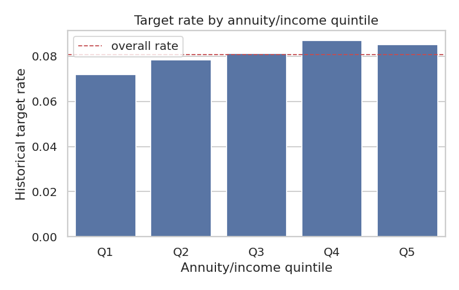

- **What is analysed:** Target rate by instalment burden.
- **Why it matters:** Payment burden is a classic affordability measure.
- **Observation (computed):** Q1: 7.20%; Q2: 7.83%; Q3: 8.13%; Q4: 8.70%; Q5: 8.52%
- **Business interpretation:** Higher burden groups warrant closer assessment if rates rise.
- **Limitations:** Association, not causation.

### Household characteristics
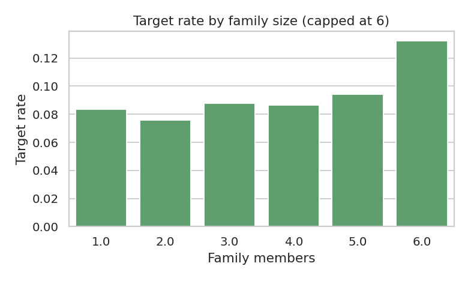

- **What is analysed:** Target rate by family size.
- **Why it matters:** Dependants increase living costs.
- **Observation (computed):** 1: 8.36% (n=67,847); 2: 7.58% (n=158,357); 3: 8.76% (n=52,601); 4: 8.65% (n=24,697); 5: 9.40% (n=3,478); 6: 13.23% (n=529)
- **Business interpretation:** Check whether large households carry elevated rates.
- **Limitations:** Small cells at the tail are noisy.

### Existing credit exposure (bureau credit count)
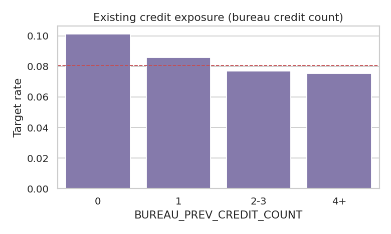

- **What is analysed:** Target rate across levels of BUREAU_PREV_CREDIT_COUNT.
- **Why it matters:** Past behaviour is typically the strongest signal in credit data.
- **Observation (computed):** 0: 10.12% (n=44,020); 1: 8.59% (n=36,072); 2-3: 7.71% (n=68,560); 4+: 7.54% (n=158,859)
- **Business interpretation:** Monotone increases would validate behavioural features.
- **Limitations:** Applicants without history are excluded or form separate groups.

### Repayment behaviour (late payment ratio)
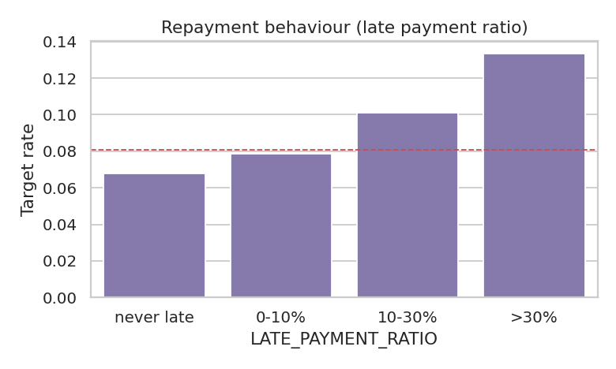

- **What is analysed:** Target rate across levels of LATE_PAYMENT_RATIO.
- **Why it matters:** Past behaviour is typically the strongest signal in credit data.
- **Observation (computed):** never late: 6.80% (n=136,636); 0-10%: 7.85% (n=74,713); 10-30%: 10.12% (n=62,046); >30%: 13.34% (n=18,240)
- **Business interpretation:** Monotone increases would validate behavioural features.
- **Limitations:** Applicants without history are excluded or form separate groups.

### Previous application rejections
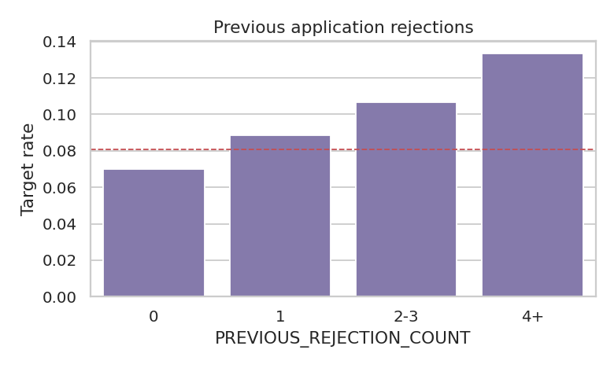

- **What is analysed:** Target rate across levels of PREVIOUS_REJECTION_COUNT.
- **Why it matters:** Past behaviour is typically the strongest signal in credit data.
- **Observation (computed):** 0: 6.98% (n=207,217); 1: 8.83% (n=46,534); 2-3: 10.65% (n=34,598); 4+: 13.34% (n=19,162)
- **Business interpretation:** Monotone increases would validate behavioural features.
- **Limitations:** Applicants without history are excluded or form separate groups.

### Missingness
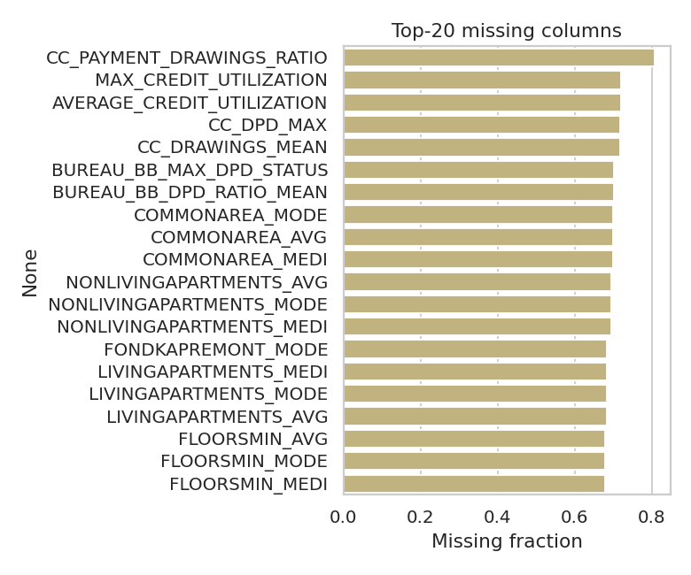

- **What is analysed:** Fraction of missing values per column.
- **Why it matters:** Drives imputation, feature selection and monitoring rules.
- **Observation (computed):** Highest: CC_PAYMENT_DRAWINGS_RATIO at 80.7%; 48 columns exceed 50% missing.
- **Business interpretation:** Structural missingness (no bureau record, no card) is informative and handled with HAS_* flags.
- **Limitations:** Missing-at-random is not assumed.

### Outliers
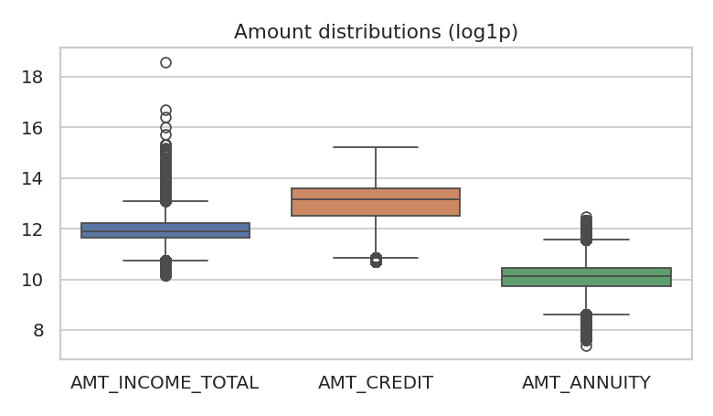

- **What is analysed:** Boxplots of main amounts and share above Q3+3*IQR.
- **Why it matters:** Extreme values can distort linear models and ratios.
- **Observation (computed):** AMT_INCOME_TOTAL: 0.98% extreme; AMT_CREDIT: 0.14% extreme; AMT_ANNUITY: 0.33% extreme
- **Business interpretation:** Tree models are robust; linear model uses scaling and median imputation.
- **Limitations:** No winsorising applied; extremes may be valid high-value loans.

### Correlation with TARGET
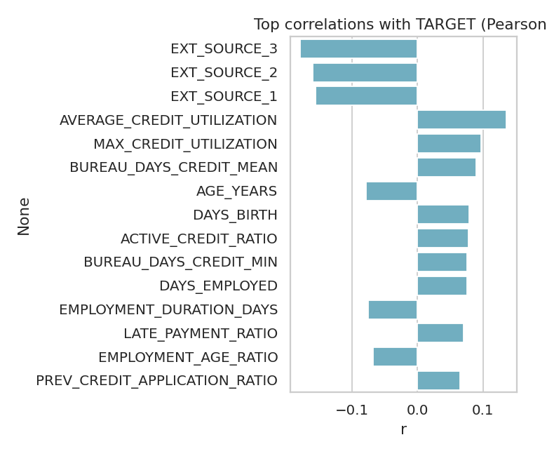

- **What is analysed:** Pearson correlation of numeric features with the label.
- **Why it matters:** Quick screening of signal strength.
- **Observation (computed):** EXT_SOURCE_3: -0.179; EXT_SOURCE_2: -0.160; EXT_SOURCE_1: -0.155; AVERAGE_CREDIT_UTILIZATION: +0.136; MAX_CREDIT_UTILIZATION: +0.097
- **Business interpretation:** Individually weak correlations are typical; models combine many weak signals.
- **Limitations:** Linear correlation misses non-linear effects.
