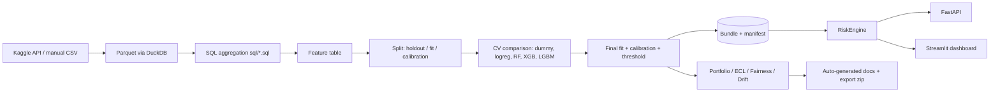

# Architecture

**Modules (`src/creditiq`)**: config (paths, checkpoints), data_io, audit, aggregate, features, stats, eda, modeling, evaluation, calibration, explain, risk_engine, ecl, portfolio, fairness, monitoring, artifacts, reporting, pipeline, synthetic (smoke tests only).

**Splits.** Stratified: 20% untouched holdout; remaining development set -> 75% fit / 25% calibration. CV model comparison uses the development set only.

**Preprocessing.** FeatureSelector (missingness, constants, near-duplicate numerics) + ColumnTransformer; three variants (linear: impute+scale+one-hot; tree_nan: NaN-native boosters; tree_imputed: RF/dummy). Fitted on training data only.

**Resumability.** `logs/pipeline_state.json` records completed stages; every SQL aggregate and Parquet table is a checkpoint; CV results are cached.
